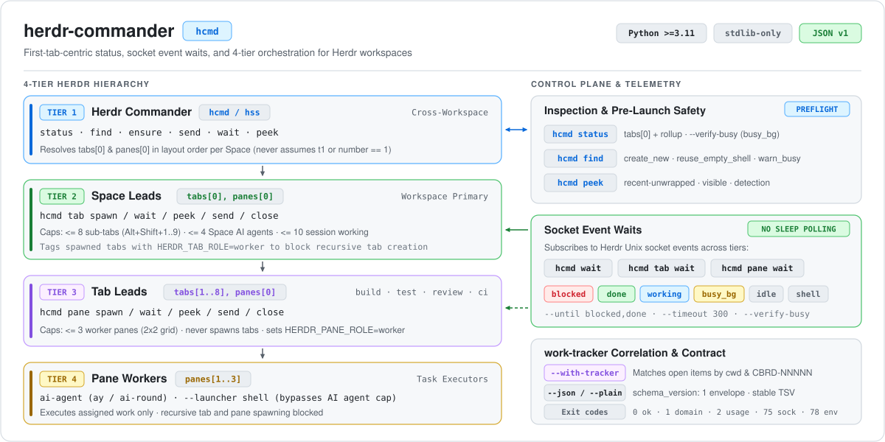

<div align="center">

<picture>
  <source media="(prefers-color-scheme: dark)" srcset="assets/readme/hero-dark.svg">
  <source media="(prefers-color-scheme: light)" srcset="assets/readme/hero-light.svg">
  
</picture>

# herdr-commander (`hcmd`)

**First-tab-centric status inspection, socket-driven event waits, and guarded 4-tier orchestration for Herdr workspaces.**

Zero runtime dependencies (Python &ge;3.11 standard library) &middot; Strict `--json` / `--plain` / human output &middot; Legacy `hss` alias preserved

[Why This Exists](#why-this-exists) &middot; [Install](#install) &middot; [Commands](#commands) &middot; [Hierarchy &amp; Guardrails](#hierarchy-and-guardrails) &middot; [JSON Contract &amp; Exit Codes](#json-contract-and-exit-codes) &middot; [Architecture](#architecture) &middot; [Development](#development)

</div>

---


## Why This Exists

Running multiple coding agents across Herdr workspaces breaks down fast when coordinators poll with `sleep`, guess which tab holds the workspace lead, or spawn unbounded nested agents. `herdr-commander` (`hcmd`) gives both humans and AI coordinators a deterministic control plane built around four invariants:

1. **4-tier Herdr hierarchy with role enforcement**:
   - **Herdr Commander (`hcmd`)** coordinates asynchronously across Spaces (`digest`, `status`, `find`, `ensure`, `send`, `peek`, and opt-in `wait`).
   - **Space Leads (`tabs[0]`, `panes[0]`)** manage up to 8 sub-tabs (`Alt+Shift+1..9`) via `hcmd tab` and tag spawned sub-tabs with `HERDR_TAB_ROLE=worker`.
   - **Tab Leads (`tabs[1..8]`, `panes[0]`)** manage up to 3 worker panes (`2×2` grid) inside their own tab via `hcmd pane`, tag split panes with `HERDR_PANE_ROLE=worker`, and never create tabs.
   - **Pane Workers (`panes[1..3]`)** execute assigned work only; recursive tab and pane spawning is blocked.
2. **Layout-order `tabs[0]` inspection**: `hcmd` never assumes a workspace's primary tab is `t1` or `number == 1`. It always resolves `tabs[0]` and `panes[0]` in Herdr layout order and rolls up all sub-tabs and split panes alongside it.
3. **Socket event waits instead of `sleep` polling**: `hcmd wait`, `hcmd tab wait`, and `hcmd pane wait` subscribe directly to Herdr Unix socket events until watched agents enter target states (`blocked`, `done`, `working`, `busy_bg`, `idle`, `shell`, `unknown`), using `--verify-busy` when Claude background tasks need detection-buffer confirmation.
4. **Pre-launch deduplication & `work-tracker` correlation**: `hcmd find` and `hcmd ensure --on-existing {reuse,fail,new}` prevent duplicate workspaces before worktrees are created, while `--with-tracker` correlates open `work-tracker` items by `cwd` and `CBRD-NNNNN` ticket tokens.

## Install

Run from a clean `main` checkout:

```bash
just sync
```

This installs `herdr-commander`, `hcmd`, and compatibility alias `hss` via `uv tool install --reinstall .` and copies every skill directory under `skills/*` (`herdr-commander`, `herdr-commander-init`, `hcmd-init`, `hcmd-check`, `hcmd-auto`) into `~/.agents/skills/<skill>`, symlinking it for:

- `~/.agents/skills/<skill>`
- `~/.claude/skills/<skill>` (Claude)
- `${CODEX_HOME:-~/.codex}/skills/<skill>` (Codex)
- `~/.gemini/config/skills/<skill>` (Antigravity / `agy`)

## Commands

All subcommands accept common output and socket flags: `--json`, `--plain`, `--no-color`, and `--socket PATH` (which overrides the `HERDR_ENV=1` check). Top-level `hcmd --version` prints the installed version.

| Command | Tier | Purpose |
| --- | --- | --- |
| `hcmd digest` | Commander | Non-blocking summary + `peek` snippets for `blocked`/`done`/blocked-subtab Spaces |
| `hcmd status` | Commander | Inspect every Space via `tabs[0]` plus sub-tab/pane rollups |
| `hcmd find` | Commander | Pre-launch lookup by name, label, `cwd`/`pwd`, ticket, or PR |
| `hcmd peek` | Commander | Read recent terminal output from a Space pane (default: first-tab pane) |
| `hcmd ensure` | Commander | Idempotently create or reuse a workspace and start its first-tab agent |
| `hcmd send` | Commander | Validate readiness and dispatch a prompt (inline or `--prompt -` stdin) |
| `hcmd wait` | Commander (opt-in) | Blocking wait on Herdr socket events until watched tabs/deltas match |
| `hcmd self-context` | Commander | Parse calling pane statusline context window % and rate-limit telemetry |
| `hcmd rotate` | Commander | 2-phase same-tab Commander pane rotation with handoff state & `--ack` |
| `hcmd tab` | Space Lead | `list`, `spawn`, `peek`, `send`, `wait`, `close` sub-tabs in own Space |
| `hcmd pane` | Tab / Space Lead | `list`, `spawn`, `peek`, `send`, `wait`, `close` worker panes in own tab |

### `digest`

Non-blocking Commander check-in command. Defaults to `--workers-only`, `--verify-busy`, and `--with-tracker`, summarizing worker counts and automatically peeking `blocked`, `done`, and `sub_tabs.any_blocked` panes in one call:

```bash
hcmd digest
hcmd digest --since-last --compact --json
hcmd digest --since-last --cursor auto-watch --no-advance --json
hcmd digest --all --include-idle --peek-lines 0
hcmd digest --workspace CBRD-10001 --peek-lines 60
```

- `--since-last` tracks per-workspace watermarks under `${XDG_STATE_HOME:-~/.local/state}/herdr-commander/cursors/` (overridable via `--cursor NAME`, `--no-advance`, `--reset-cursor`), catching `working`/`busy_bg` -> `idle` transitions (`settled_idle`), deduplicating unchanged `revision` ticks via normalized `peek_hash`, omitting unchanged `blocked` re-peeks (`still_blocked`), and reporting `closed_workspaces`.
- `--compact` defaults `--peek-lines` to `20`, trims statusline/chrome, prefers structured `Status / Summary / Evidence / Blockers / Next` tails, and bounds peek length (`--max-peek-chars`, default `1500`).
- `--all` includes `working`/`idle`/`shell` Spaces in addition to attention-needed ones; `--include-idle` peeks `idle` agent Spaces; `--workspace` digests a single Space; `--include-self` includes the caller's Space; `--no-verify-busy` / `--no-tracker` disable extra checks; `--peek-lines 0` skips terminal reads.

### `status`

Inspect every workspace through its first tab (`tabs[0]` per workspace, regardless of tab ID or number) plus a rollup of all sub-tabs and split panes:

```bash
hcmd status
hcmd status --workers-only --verify-busy --with-tracker --json
hcmd status --plain --fields number,workspace_id,attention,agent_kind,label
```

- `--workers-only` excludes the caller's own `HERDR_WORKSPACE_ID`; `--attention-only` filters to `blocked`, `done`, `shell`, or `idle`; `--workspace` filters to one workspace ID, label, or ticket; `--all-tabs` includes the full tab inventory; `--sort {attention,number}` controls ordering.
- `--verify-busy` checks `agent.read(..., source="detection")` on `idle`/`done` Claude panes and marks background-active panes as `busy_bg` (counted under `working`).
- `--with-tracker` correlates workspaces with open `work-tracker` items by `cwd` and `CBRD-NNNNN` ticket token.

### `find`

Check before launching whether an existing Herdr workspace already matches a target name, label, working directory (`--cwd`/`--pwd`), ticket, or PR:

```bash
hcmd find --label my-repo --cwd ~/gh/my-repo --verify-busy --json
hcmd find --ticket CBRD-10002 --verify-busy --json
hcmd find demo-lead --json
```

- Supports positional `query` and explicit `--name`, `--label`, `--cwd` / `--pwd`, `--ticket`, and `--pr` filters, plus `--verify-busy`, `--with-tracker`, `--include-self`, and `--include-deleted`.
- Exits `0` both when matches are found (`found: true`) and when none match (`found: false`), reporting a state-aware `recommendation`:
  - `create_new`: no matching workspace exists.
  - `reuse_empty_shell`: single exact primary match running an empty shell (`agent_kind: null`).
  - `ask_reuse`: idle/done agent match or multiple candidate workspaces.
  - `warn_busy`: at least one matched workspace (or its sub-tabs) is `working`, `busy_bg`, or `blocked`.
- Matches workspace labels, primary and sub-pane agent names, primary/foreground/sub-pane working directories (including symlinks and subdirectories under the target directory), tickets, and PR tokens while excluding `is_self` and `deleted_hint` workspaces by default.

### `peek`

Read recent terminal output from a workspace pane (default: first-tab pane):

```bash
hcmd peek w1 --lines 60
hcmd peek w1 --tab review --lines 60
hcmd peek w1 --pane p2 --verify-busy
hcmd peek CBRD-10001 --source visible --json
```

- Supports `--tab` (tab ID, 1-based tab index, or role label), `--pane` (pane ID, 1-based index, or agent name), `--verify-busy`, `--lines` (default `40`), and `--source` (`recent-unwrapped` default, `visible`, `recent`, `detection`).

### `wait` (opt-in)

Opt-in blocking wait on Herdr socket events until watched Spaces match `--until` or emit a delta:

```bash
hcmd wait --until blocked,done --timeout 300 --verify-busy --json
hcmd wait --since-last --include-subtabs --emit-digest --compact --stop-when-idle --allow-timeout --timeout 600 --verify-busy --json
```

- Supports `--workspace`, `--all-workspaces`, `--timeout` (default `300`), and `--verify-busy`.
- Transition/watch flags: `--since-last` / `--changes-only` (ignore already-settled Spaces at startup), `--cursor` / `--no-advance`, `--include-subtabs` (watch sub-tab panes and `sub_tabs.any_blocked`), `--stop-when-idle` (exit immediately with `reason: "no_active_work"` when nothing is active), `--allow-timeout` (exit `0` with `timed_out: true`), `--emit-digest`, `--compact`, `--peek-lines`, `--max-peek-chars`, and `--with-tracker`.

### `self-context` & `rotate`

Inspect the calling pane's context-window usage from its rendered `ay` / `claude` statusline and rotate cleanly inside the same tab when context exceeds threshold:

```bash
hcmd self-context --rotate-ctx 30 --json
hcmd rotate --rotate-ctx 30 --cursor auto-watch --auto-config "cubrid-pr-sync-standing-allowlist" --json
hcmd rotate --ack <old_pane_id> --json
```

- `hcmd rotate` splits the caller's tab (`t1`, preserving `tabs[0]` and all sub-tabs), enforces a 300s cooldown (`--cooldown`, `--force`), saves handoff state under `${XDG_STATE_HOME:-~/.local/state}/herdr-commander/handoff/` (propagating `/hcmd-auto` standing policy summaries via `--auto-config`), launches the successor agent (`ay` default, dismissing any startup overlay and verifying `working`), and leaves the old pane alive until the successor completes init and runs `hcmd rotate --ack <old_pane_id>`.

### `ensure`

Idempotently converge a workspace and its first-tab agent:

```bash
hcmd ensure --ticket CBRD-10002 --on-existing fail --launcher ai-agent --json
hcmd ensure --reuse w2 --launcher ai-agent --json
hcmd ensure --cwd ~/gh/my-repo --pwd ~/gh/my-repo --label my-repo --on-existing new --launcher ai-agent --json
```

| Launcher | Herdr agent kind | Notes |
| --- | --- | --- |
| `ai-agent` (default) | `agy` or `claude` | Picks `ay` or `ai-round` by remaining quota and never selects Codex. |
| `ay` | `agy` | Antigravity CLI. |
| `ai-round` | `claude` | Claude round-robin across numbered slots. |
| `ai-best` | `claude` | Strongest Claude setup. |
| `codex`, `claude` | `codex`, `claude` | Direct `herdr agent start` in bypass mode. Use only on explicit request. |
| `shell` | none | Workspace only, no agent. |

- `ai-agent` runs `ai-agent --dry-run --json` before creating a workspace. `--dry-run` reports the predicted agent kind, and a quota failure such as `AI_AGENT_NO_ELIGIBLE_BACKEND` stops before any worktree is created. Either `agy` or `claude` in the first tab counts as a match for reuse and readiness.
- Uses the same `find_matching_spaces` matcher as `hcmd find`, controlled by `--on-existing {reuse,fail,new}`:
  - `reuse` (default): reuses an exact primary match and matching first-tab agent.
  - `fail`: aborts before creating or reusing (`EXISTING_WORKSPACE_FOUND`) and returns `recommendation` + `matches` (with Claude `busy_bg` verification) in `error.details`.
  - `new` (or shorthand `--new`): creates a fresh `--cwd`/`--pwd` workspace even when a matching workspace exists.
- `--reuse <target>` explicitly targets an existing workspace ID, label, or ticket to ensure/launch its first-tab agent.
- Delegates `--ticket` and `--pr` (with optional `--base`) workspace creation to `cubrid-worktree` and `--cwd` creation to `herdr-next-to-current` or `herdr workspace create --no-focus`, waiting up to `--ready-timeout` seconds (default `45`).
- Automatically pre-trusts the target directory in Claude (`~/.claude.json`), Codex (`~/.codex/local.config.toml`), and Antigravity (`~/.gemini/antigravity-cli/settings.json`) configs before launching an AI agent (`--no-trust` to skip; also enabled on `hcmd tab spawn` and `hcmd pane spawn`).
- Refuses to overwrite a first-tab pane already occupied by a different agent kind (`OCCUPIED_BY_OTHER_AGENT`).

### `send`

Validate first-tab readiness and send a prompt (supports `--prompt -` from stdin, opt-in `--wait` with `--timeout` default `120`, and `--dry-run`; default is async fire-and-return):

```bash
hcmd send w1 --kickoff --tracker "#1124" --context "Single writer in this worktree" --prompt - --json <<'EOF'
Objective: Run targeted tests and report results.
EOF
hcmd send w1 --prompt "1. Proceed." --json
```

- `--kickoff` (with optional `--tracker <ID>` and repeatable `--context <TEXT>`) prepends the Minimal Commander Context Envelope (Space Lead role, human-in-the-loop Tab 1 note, `hcmd tab` hygiene, external-write boundaries, and `Status / Summary / Evidence / Decision / Next` reporting rule) for initial task dispatch. Omit `--kickoff` on follow-ups to keep prompts raw.
- Refuses `blocked` agents (`AGENT_BLOCKED`), `working`/`busy_bg` agents without `--force` (`AGENT_BUSY`), and the caller's own workspace without `--force` (`CANNOT_SEND_TO_SELF`).

## Hierarchy and Guardrails

### `tab` (Space Lead)

Manage worker sub-tabs inside the caller's own Space (up to 8 sub-tabs by default, total 9 tabs matching `Alt+Shift+1..9`). Enforces Space Lead identity (`tabs[0]`, `panes[0]`, not `HERDR_TAB_ROLE=worker` or `HERDR_PANE_ROLE=worker`) and tags created tabs with `HERDR_TAB_ROLE=worker` to block recursive tab spawning.

```bash
hcmd tab list --verify-busy
hcmd tab spawn --label review --launcher ai-agent --prompt "Review current diff." --json
hcmd tab wait --until blocked,done --verify-busy --json
hcmd tab peek review --lines 60
hcmd tab send review --prompt "Check edge cases." --json
hcmd tab close review
```

### `pane` (Tab Lead)

Manage worker panes inside the caller's own tab (up to 3 worker panes by default, forming a `2×2` grid via `--direction {auto,right,down}`). Allowed for Space/Tab Leads (`panes[0]`, not `HERDR_PANE_ROLE=worker`); tags split panes with `HERDR_PANE_ROLE=worker`.

```bash
hcmd pane list --verify-busy
hcmd pane spawn --launcher ai-agent --prompt "Audit tests." --json
hcmd pane spawn --launcher shell --cmd "just test" --json
hcmd pane wait --until blocked,done --verify-busy --json
hcmd pane peek p2 --lines 60
hcmd pane send p2 --prompt "Summarize failures." --json
hcmd pane close p2
```

### Default Guardrail Caps

Override via CLI flags or environment variables (legacy `HSS_MAX_*` fallbacks are also accepted; `0` = unlimited):

| Environment Variable | Default | CLI Flag | Scope & Behavior |
| --- | --- | --- | --- |
| `HCMD_MAX_SUB_TABS` | `8` | `--max-sub-tabs` | Max non-primary sub-tabs per Space (`hcmd tab spawn`) |
| `HCMD_MAX_WORKER_PANES` | `3` | `--max-worker-panes` | Max non-primary worker panes per tab (`hcmd pane spawn`) |
| `HCMD_MAX_SPACE_AGENTS` | `4` | `--max-space-agents` | Max live non-primary AI agents per Space (`--launcher shell` bypasses) |
| `HCMD_MAX_SESSION_AGENTS` | `10` | `--max-session-agents` | Max currently working AI agents across the Herdr session (`--launcher shell` bypasses) |

## JSON Contract and Exit Codes

Under `--json`, stdout emits only:

```json
{ "ok": true, "schema_version": 1, "data": { ... } }
```

Failures leave stdout empty and write one structured JSON line to stderr:

```json
{ "ok": false, "error": { "code": "...", "message": "...", "fix": "...", "transient": false } }
```

| Exit code | Meaning |
| --- | --- |
| `0` | Success |
| `1` | Domain failure (missing target, occupied pane, blocked/busy agent, timeout) |
| `2` | Invalid CLI usage or flags |
| `75` | Temporary retry-safe Herdr socket error |
| `78` | Environment or configuration error (`HERDR_ENV != 1`, missing dependency) |
| `130` | Interrupted by `SIGINT` |

## Architecture

Business logic stays pure and testable in the Python ≥3.11 standard library, with socket/subprocess I/O isolated in `herdr_client.py` and stream/exit handling isolated in `cli.py`:

| Module | Responsibility |
| --- | --- |
| [`src/herdr_commander/models.py`](src/herdr_commander/models.py) | Domain dataclasses, attention order, exit codes, and `CliError` |
| [`src/herdr_commander/herdr_client.py`](src/herdr_commander/herdr_client.py) | Unix socket RPC/event client and subprocess adapters (`herdr`, `cubrid-worktree`, `herdr-next-to-current`, `work-tracker`) |
| [`src/herdr_commander/snapshot.py`](src/herdr_commander/snapshot.py) | Pure snapshot parsing, `tabs[0]` / `panes[0]` resolution, role checks, sub-tab rollup, Claude `busy_bg` classification, `work-tracker` correlation |
| [`src/herdr_commander/orchestrate.py`](src/herdr_commander/orchestrate.py) | Pure planning and execution for `ensure`, `send`, `wait`, `tab`, and `pane` |
| [`src/herdr_commander/formatters.py`](src/herdr_commander/formatters.py) | Output mode detection and `human`, `plain`, and `json` renderers |
| [`src/herdr_commander/cli.py`](src/herdr_commander/cli.py) | CLI entry point; sole module writing to stdout/stderr or exiting |
| [`skills/herdr-commander/SKILL.md`](skills/herdr-commander/SKILL.md) | Compatibility wrapper delegating across Commander skills |
| [`skills/herdr-commander-init/SKILL.md`](skills/herdr-commander-init/SKILL.md) | Canonical bootstrap, dispatch, and `--handoff` resume skill (`hcmd-init` alias) |
| [`skills/hcmd-check/SKILL.md`](skills/hcmd-check/SKILL.md) | Lean delta harvest and decision-first Korean brief skill |
| [`skills/hcmd-auto/SKILL.md`](skills/hcmd-auto/SKILL.md) | Event-driven autonomous watch loop, fail-closed & conditional standing safety allowlist, and self-rotation skill |
| [`hcmd.just`](hcmd.just) | Parameterless `hcmd` CLI lifecycle and query presets (`just --list hcmd` / `just hcmd <recipe>`) |

## Development

```bash
just check
just --choose
```

Parameterless `hcmd` CLI lifecycle and query presets live in [`hcmd.just`](hcmd.just) (`just --list hcmd` / `just hcmd <recipe>`).
